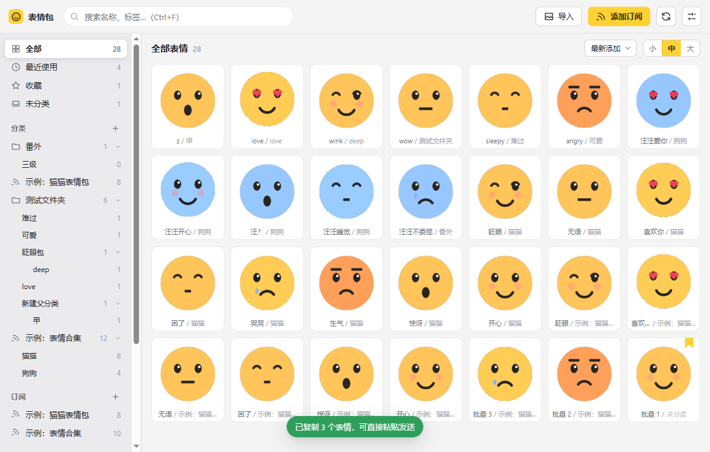
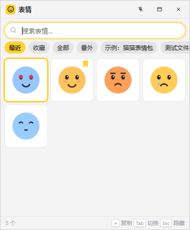
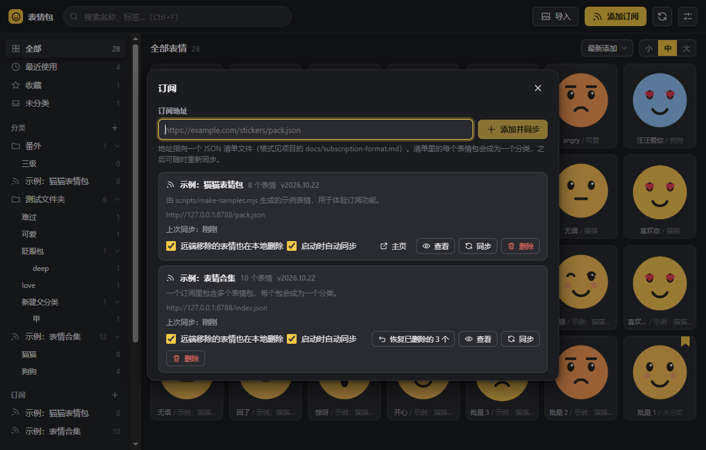

<div align="center">


# 表情包管理器 Emoji Manager

本地管理表情包：多级分类、标签、收藏、搜索，点一下就复制；全局快捷键呼出桌面浮窗；输入订阅地址自动同步别人分享的表情包。

[下载最新版](https://github.com/Lony225/emoji-manager/releases/latest) · [更新日志](CHANGELOG.md) · [订阅格式](docs/subscription-format.md) · [设计文档](docs/设计文档.md)

</div>



## 下载安装

到 [Releases](https://github.com/Lony225/emoji-manager/releases/latest) 页面下载：

| 系统 | 文件 | 说明 |
|---|---|---|
| Windows 10 / 11 | `Emoji.Manager-x.y.z-win-x64.exe` | 安装版：向导安装，开始菜单快捷方式，可设开机自启 |
| Windows 10 / 11 | `Emoji.Manager-x.y.z-portable.exe` | 便携版：双击直接运行，不写注册表，删掉即卸载 |
| macOS（Apple Silicon） | `Emoji.Manager-x.y.z-mac-arm64.dmg` | M1 / M2 / M3 / M4 |
| macOS（Intel） | `Emoji.Manager-x.y.z-mac-x64.dmg` | |
| Android 7.0+ | `Emoji.Manager-x.y.z-android.apk` | 手机版：点一下表情就打开系统分享面板发到微信 / QQ，长按有更多操作；相册 / 微信里「分享到」本应用即可存入 |

安装包目前没有代码签名：

- Windows 的 SmartScreen 提示时，点「更多信息 → 仍要运行」。
- macOS 首次打开被拦下时，到「系统设置 → 隐私与安全性」里点「仍要打开」。
- Android 需要允许「安装未知来源应用」；apk 用自己的签名密钥签名，以后的版本可以直接覆盖安装。

应用启动时会检查 GitHub 上的新版本，有更新会弹窗提示并给出下载链接，不会自动安装；可在设置里关闭。

## 功能

| | |
|---|---|
| 导入 | 选择图片、拖拽进窗口（本地文件，或直接从浏览器拖网页上的图片；拖到某个分类上就放进去）、`Ctrl+V` 粘贴或点「粘贴」（截图、复制的图片 / 文件、网页图片，GIF 保留动画）；按内容去重，相同图片再次导入到某个分类时会把已有的移过去，不会重复 |
| 文件夹导入 | 一次选多个文件夹（或一起拖进窗口），每个文件夹成为一个分类，子文件夹逐级成为子分类；可放在任意分类下 |
| 分类 | 像文件夹一样任意多级：侧栏缩进可折叠，拖动调整顺序或拖到任意分类上成为它的子分类；进入分类后顶部页签切换子分类、面包屑回到上级 |
| 标签 | 多标签、输入联想、侧栏标签云筛选（可多选）、全局重命名 / 删除 |
| 制作 | 给任意表情或图片加文字做成新表情：实时预览、拖动摆放，字体 / 字号 / 颜色 / 描边 / 阴影 / 底色可调，有一键样式；动图逐帧加字并重新编成 GIF，动画不丢。「用模板做表情」内置 [meme-generator](https://github.com/MemeCrafters/meme-generator-rs) 的 299 个沙雕模板（摸头、喜报、举牌……），选图填字即生成，直接复制或存为表情；首次使用下载一次字体（约 77 MB），模板素材按需下载 |
| 命名 | 每个表情下方一行显示「名称 / 分类」，点名称或按 `F2` 就地改名；多选后「批量改名」：统一名称加序号、加前缀后缀、查找替换（支持正则）、逐个修改，改前实时预览 |
| 使用 | 点击即复制（动图默认按文件复制以保留动画）；网格显示缩略图，动图播放可选全部 / 自动 / 悬停，几百张 GIF 也不卡；拖动框选、`Ctrl` / `Shift` 点选、筛选条上的「全选」按钮（或 `Ctrl+A`），多选后一键把多个文件一起复制、粘贴即发送 |
| 手机 | Android 版是同一套界面：点一下表情打开系统分享面板，选微信 / QQ 直接发送（可在设置里改成复制到剪贴板）；长按表情出菜单；多选后一起分享；相册、微信、浏览器里把图片「分享到」本应用即可存入，zip 表情包也能这样导入；导出 zip 走分享面板，发给文件传输助手或存到文件应用。模板表情、浮窗、文件夹导入是桌面版才有的 |
| 浮窗 | 全局快捷键（默认 `Alt+Shift+E`）呼出置顶小窗：打开即是「最近使用」，输入即搜索，`Enter` 或点击复制后自动隐藏；可「固定」常驻 |
| 托盘 | 关闭主窗口最小化到托盘，快捷键照常可用；安装版可设开机自启 |
| 订阅（暂未开放） | 输入 JSON 清单地址即同步；增量更新、保留你改过的名字 / 标签 / 分类、启动时自动同步。当前版本先隐藏了入口，之后开放 |
| 分享 | 任意选中的表情、整个分类（含所有子分类）或全部，导出成 zip（含名称、标签、多级分类），对方导入即还原 |
| 数据 | `library.json` + `stickers/` 目录，可改到同步盘目录在多台电脑间共用；自动保留上一版备份 |

<p align="center">
  
  &nbsp;&nbsp;
  
</p>

## 浮窗怎么用

1. 在任何程序里按 `Alt+Shift+E`（可在设置里改），浮窗出现在鼠标所在屏幕的右下角并聚焦搜索框。
2. 直接打字搜索名称或标签；`↑ ↓ ← →` 移动，`Enter` 复制，`Tab` 在「最近 / 收藏 / 全部 / 各分类」之间切换，`Esc` 隐藏。
3. 复制后浮窗自动隐藏，回到聊天窗口 `Ctrl+V` 粘贴即可。
4. 想让它一直留在桌面上，点标题栏的图钉「固定」：固定后复制和失焦都不会隐藏。
5. 浮窗是只读的：改名、打标签、删除等操作在主窗口完成，浮窗会自动跟着刷新。

## 表情包预览网站

仓库的 `site/` 目录是一个可以自己部署的小网站（Node）：公开浏览表情包、点击复制单张、「导入到表情包管理器」一键订阅（应用 1.1 起支持 `emojimanager://` 协议链接）、下载 zip；表情包按分类层级展示，每个分组都有自己的订阅地址（一次订阅一个一级分类连同它下面的所有子分类）；管理员登录后上传整理，也能直接导入应用导出的 zip，分类层级原样保留。部署方法见 [site/README.md](site/README.md)。

## 订阅：分享你的表情包（暂未开放）

> 订阅功能的代码已经就绪，当前版本先隐藏了界面入口，后续版本开放。下面的格式说明供提前准备素材参考。

把图片和一个 JSON 清单放到任何静态托管（GitHub Pages、对象存储、自己的服务器），别人在应用里输入清单地址就能订阅，你更新清单后他们重新同步即可：

```json
{
  "name": "猫猫表情包",
  "tags": ["猫"],
  "stickers": [
    "images/01.gif",
    { "id": "02", "url": "images/02.png", "name": "开心", "tags": ["开心"] }
  ]
}
```

完整格式、多包订阅、合并规则见 [docs/subscription-format.md](docs/subscription-format.md)。应用「导出」生成的 zip 解压后就是这个格式。

## 数据位置

- Windows：`%APPDATA%\emoji-manager\library`
- macOS：`~/Library/Application Support/emoji-manager/library`
- Android：应用私有目录 `files/library`（卸载应用会一并删除，备份请用「设置 → 导出全部」）
- 目录内：`library.json`（资料）、`library.json.bak`（上一版备份）、`stickers/`（图片）、`usage.json`（最近使用记录）
- 模板表情的字体、素材和预览缓存在上一级的 `meme-generator/` 目录（不随数据目录迁移，删掉会重新下载）
- 可在「设置 → 数据目录 → 更改」换到任意目录（会把现有数据复制过去）

退出程序：右键托盘图标选「退出」，或在设置里关掉「关闭主窗口时最小化到托盘」后直接关窗口。

## 开发

需要 Node 22 和 pnpm。

```bash
pnpm install
pnpm samples          # 生成示例表情和应用图标
pnpm dev:electron     # 桌面版开发模式（热更新）
pnpm dev              # 浏览器版：http://localhost:5173
pnpm serve:samples    # 本地示例订阅源：http://127.0.0.1:8787/pack.json
```

检查与测试：

```bash
pnpm typecheck
pnpm test             # 单元测试
pnpm e2e:electron     # 启动真实 Electron 跑完整流程（导入、订阅、浮窗、拖拽、导出导入、重启）
```

打包：

```bash
pnpm dist:win         # release/ 下生成 Windows 安装包和便携版
pnpm dist:mac         # 需要在 macOS 上执行
pnpm dist:android     # release/ 下生成 Android apk（见下）
```

Android 版用 [Capacitor](https://capacitorjs.com/) 把同一套页面装进原生壳，工程在 `android/`：

- 需要 Android SDK（设 `ANDROID_HOME`，或在 `android/local.properties` 里写 `sdk.dir=…`）和 JDK 21（装了 Android Studio 的话脚本会自动用它自带的 `jbr`，也可以设 `EMOJI_ANDROID_JAVA_HOME`）。缺少的 SDK 组件（API 36 平台等）Gradle 会自动下载。
- 签名：把密钥信息写在 `android/keystore.properties`（不入库）里，格式是 `storeFile=…`、`storePassword=…`、`keyAlias=…`、`keyPassword=…`；也可以用环境变量 `EMOJI_ANDROID_KEYSTORE_PROPERTIES` 指向这个文件。没有的话用调试签名，能装能用，但不能和正式签名的包互相覆盖安装。
- `pnpm dist:android --dev` 给文件名加 `-dev-日期` 后缀，`--debug` 打调试包，`pnpm android:open` 用 Android Studio 打开工程。
- 版本号和 versionCode 跟着 `package.json` 走（1.3.0 → 10300）。

## 发布新版本

1. 更新 `package.json` 的 `version`，在 `CHANGELOG.md` 顶部加一节 `## v版本号 - 日期`。
2. 提交后打同名标签并推送：

```bash
git tag v1.0.1 && git push origin main v1.0.1
```

GitHub Actions 会在 Windows 和 macOS 上构建，把安装包连同 CHANGELOG 里对应的小节发布到 Releases。已安装的用户下次启动时会收到更新提示。

## 项目结构

```
electron/        主进程、preload（文件、下载、剪贴板、自定义协议、托盘、浮窗、快捷键）；memes.ts / meme-worker.ts 是模板表情引擎
android/         Android 壳（Capacitor）；app/src/main/java 里的 EmojiNativePlugin 负责剪贴板、接收分享、协议链接
src/core/        与界面无关的核心：数据模型、订阅清单解析、同步算法、导出导入、store
src/platform/    平台接口 + Electron / Android（Capacitor）/ 浏览器三套实现
src/components/  界面组件
src/float/       桌面浮窗
scripts/         构建、示例生成、端到端测试、发布说明、安卓打包
examples/        示例订阅
```

## 致谢

「用模板做表情」使用 [MemeCrafters/meme-generator-rs](https://github.com/MemeCrafters/meme-generator-rs)（MIT）的模板与渲染引擎，素材来自其仓库。

## 许可

MIT
